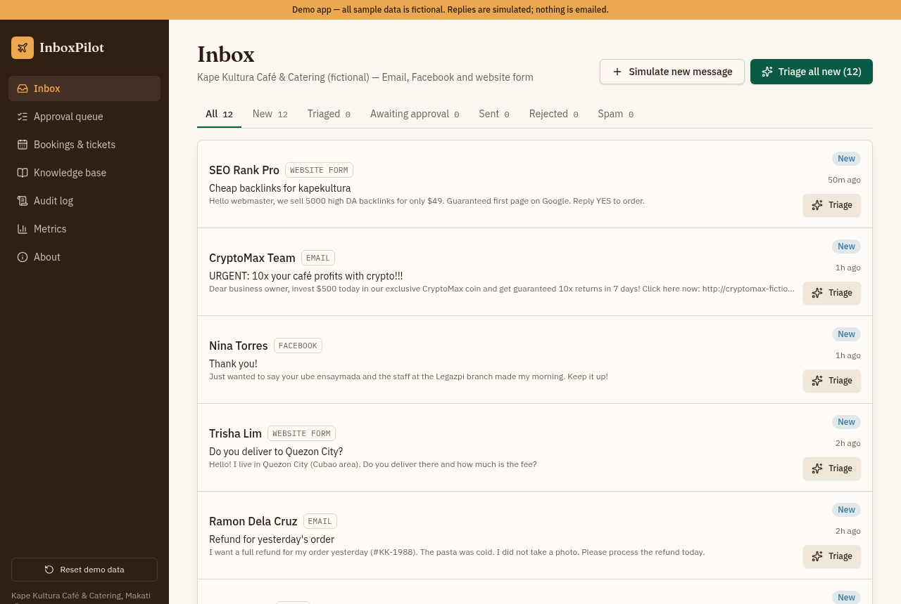
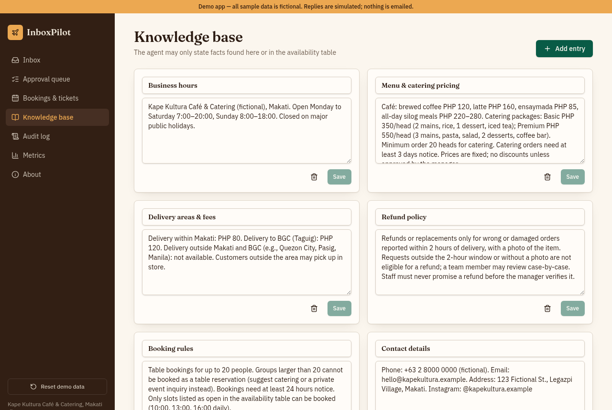
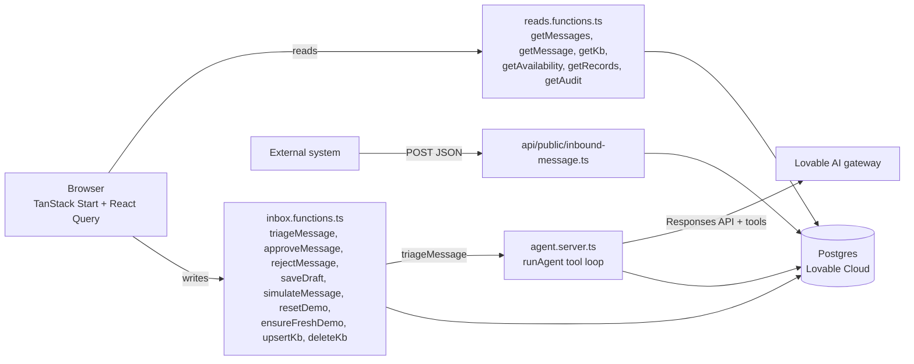

# InboxPilot

An AI triage agent for a small business inbox. It classifies messages, drafts grounded replies and proposes actions. A human approves every one of them.

**Live demo:** https://inboxpilot-uriel.lovable.app

Demo app. All sample data is fictional.



## The problem

Small businesses such as cafés and caterers get customer messages from email, Facebook and website forms. Someone has to read each one, work out what it is, look up hours, prices or open slots, and write a reply. That takes staff time every day, and a rushed reply can promise a refund, discount or booking the business cannot honor.

## What it does

- **Inbox**: messages from Email, Facebook and Website form, with status tabs (All, New, Triaged, Awaiting approval, Sent, Rejected, Spam). "Triage" per message, "Triage all new" for the batch, and "Simulate new message" to add one.
- **Message detail / approval**: the agent's analysis (intent, priority, sentiment, confidence, reasoning), an editable reply draft with "Sources used", and proposed actions as cards. Buttons: Approve & send, Save edits, Reject (with reason), Re-run agent.
- **Approval queue**: every message awaiting approval, oldest first, with intent and priority chips.
- **Bookings & tickets**: rows created only when a human approves a proposed action, plus the availability grid.
- **Knowledge base**: editable entries the agent must ground its replies in.
- **Audit log** and **Metrics**: every agent step and human decision, and KPIs computed from stored data.
- **Public webhook**: `POST /api/public/inbound-message` adds a new message from any outside system.



## How it works

The agent is a tool-calling loop with a human in the middle. For each message, the model can look things up freely (`search_knowledge_base`, `check_availability`). It can also propose side effects (`propose_booking`, `propose_ticket`, `flag_spam`), but these only write pending rows. The loop ends when the model calls `submit_triage` with structured output: intent, priority, sentiment, confidence, reasoning, reply draft and sources used.

Nothing happens until a human approves. `approveMessage` re-checks that the booking slot is still open, creates the booking, marks the slot taken, and writes audit entries. "Sending" is simulated. No real email is sent.

Guardrails in the agent instructions and in code: no refunds, discounts or availability that are not in the knowledge base or availability table. `propose_booking` rejects parties over 20, taken slots and less than 24 hours notice. Spam gets no reply draft. Approve is blocked if there is nothing to send.



All model calls run on the server. The browser never talks to the database directly: every table has Row Level Security on with no anonymous access, and all reads and writes go through server functions.

## Data model

| Table | Holds |
| --- | --- |
| `messages` | Incoming messages, status, the agent's analysis, original and edited reply draft, edit flag, timestamps |
| `proposed_actions` | Agent proposals (`create_booking`, `create_ticket`, `flag_spam`) with parameters and status: pending, executed, rejected or failed |
| `bookings` | Table bookings created on approval |
| `tickets` | Support tickets created on approval |
| `availability` | Open and taken slots (10:00, 13:00, 16:00) for the next 14 days |
| `knowledge_base` | Business facts the agent grounds replies in |
| `audit_log` | Every agent tool call, run result and human decision |

Two database functions manage the demo data. `reset_demo()` restores the seed state under an advisory lock, so concurrent visitors cannot double-seed. `ensure_fresh_demo()` runs when the app loads: it re-seeds after 24 hours idle, otherwise it tops up the 14-day availability window so seeded dates stay valid.

## Quality and testing

Browser QA of the published app, against written acceptance checks:

- All 12 seeded messages triaged in about 40 seconds (3 at a time), each with intent, priority and confidence.
- Both spam messages were flagged with no reply.
- A party of 4 got a `create_booking` for an open slot and a reply confirming the exact date and time. Approving it created the booking, marked the slot taken and wrote audit entries.
- A party of 30 was politely declined, citing the 20-person limit, with no booking proposed.
- A Quezon City delivery question was answered as outside the delivery area, citing the knowledge base.
- All 12 drafts were checked against the knowledge base: no invented prices, refunds or availability.
- Editing a draft before approving raises the edit rate on Metrics. Rejecting with a reason sets status Rejected and logs it.
- The webhook returned 201 for a valid request and 400 with clear errors for bad input (missing fields, bad email, unknown channel, body over 5,000 characters, invalid JSON).

Fixed after QA: booking replies now confirm the booking instead of saying "pending", and the About page copy button has a label and a clipboard fallback.

Automated tests (`npm test`, Vitest):

- `src/test/metrics.test.ts`: triaged count, edit rate (approved after edits ÷ approved), rejection rate and average confidence.
- `src/test/app-routing.test.tsx`: the home route `/` resolves to a page instead of "not found".

### Webhook example

```bash
curl -X POST https://inboxpilot-uriel.lovable.app/api/public/inbound-message \
  -H "Content-Type: application/json" \
  -d '{"sender_name":"Jamie Test","sender_email":"jamie@example.com","channel":"Website form","subject":"Catering for 40?","body":"Hi! Do you cater Premium for 40 people in BGC?"}'
```

`channel` must be `Email`, `Facebook` or `Website form`. The response is `201` with `{"id": "...", "status": "New"}`.

## Tech stack

- **Frontend**: React 19, TanStack Router, TanStack Query, Tailwind CSS v4, Radix UI, Recharts, Sonner
- **Server**: TanStack Start server functions and server routes, Zod validation
- **Database**: Postgres on Lovable Cloud (Supabase), Row Level Security on every table
- **AI**: Lovable AI gateway through the Vercel AI SDK (`ai`, `@ai-sdk/openai`, Responses API with tool calling)
- **Build and tests**: Vite, Vitest
- **Hosting**: Lovable (edge runtime)

## Run locally

Prerequisites: Node 22.

```bash
npm i
npm run dev
```

Environment variables (names only):

- `SUPABASE_URL`, `SUPABASE_PUBLISHABLE_KEY`, `SUPABASE_PROJECT_ID`
- `VITE_SUPABASE_URL`, `VITE_SUPABASE_PUBLISHABLE_KEY`, `VITE_SUPABASE_PROJECT_ID`
- Server-only: `SUPABASE_SERVICE_ROLE_KEY` (database access from server functions) and `LOVABLE_API_KEY` (AI calls)

AI calls use the Lovable AI gateway, which only works with Lovable Cloud. To run elsewhere, replace the model call in `src/lib/agent.server.ts` with your own model provider and key.

## Limitations and next steps

- Public demo with no login. A real deployment needs staff accounts, roles, and Row Level Security scoped per business.
- Sending is simulated. Next would be real email and Facebook integrations with delivery status.
- Knowledge base search is keyword-based over a few entries. A larger knowledge base would need embeddings and retrieval.
- Triage runs when a user clicks. A real system would triage new messages automatically in a background queue.
- QA was manual against acceptance checks. Next would be an evaluation set of labeled messages run on every prompt or model change.

## Author

Uriel Papa: [GitHub](https://github.com/Edamuza) · [LinkedIn](https://www.linkedin.com/in/uriel-papa-vitese01/)

Built with Lovable (AI app builder) from a written spec, then tested against acceptance checks and fixed.
